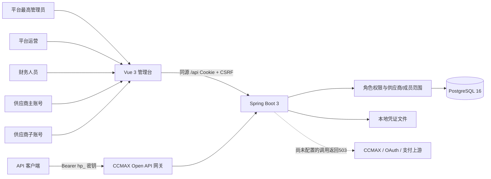

# 角色、数据与本地运行

最高管理员、平台运营与财务人员的 `supplierId` 为空，以各自业务权限控制跨供应商访问；最高管理员另掌握系统账号、角色和全局配置。主账号绑定一个供应商；成员保留父供应商ID，但资源进一步约束至本人或有管理权限的部门，项目由主账号授予。菜单显示依据auth/me权限，服务端再次校验。管理员创建/调整账户、部门权限和报价审核均写入PostgreSQL；停用账户、重置密码或权限变更使旧会话失效。

JSONB业务表hub_entity按kind和id定位、owner_id隔离、version做乐观锁；用户和登录失败计数有独立表。API密钥只保存SHA256哈希，创建/重置时返回一次明文，撤销后网关拒绝。源站39份只读响应仅作为本地首次初始化基线，业务处理从数据库读取。上传文件以随机ID保存并通过鉴权下载。

财务链路采用BigDecimal：平台录入原始金额并按有效报价计算，或明确直接录入真实金额；预览返回快照哈希，创建结算前再次校验；供应商确认后平台才可登记付款，到账确认更新收款汇总。线下付款代表操作人员提供凭证的登记行为，未调用外部资金通道。

前端84个恢复模块由唯一Vue渲染器处理，原React/ReactDOM内联实现已移除。完整DOM、样式、图标、交互与校验保留；可读角色索引在frontend/src/views/roles，源模块映射在frontend/scripts/provenance.json。该恢复方式不是原作者的原始工程源码，也不依赖源站来显示页面。

新增两个平台角色的默认权限、历史空角色迁移和本地账号说明见five-role-permissions.md。原证据不含OPERATOR/FINANCE服务端默认配置，因此本地默认策略与原站私有配置的边界在该文档明确列出。

## 当前职责收紧版本

权限策略以 security-role-policy-v3 为准：运营只可访问ownerUserId归属自己的有效供应商；财务有跨供应商账务权限但无运营写、完整受益账户和通道执行权限；成员同时满足当前项目和本人/部门条件。自定义角色只能作为同职责范围附加，后端每次请求把存储权限与职责上限及有效角色授权相交。付款PENDING→独立审核APPROVED→凭证登记SUCCEEDED，ADMIN同样不能自审或代供应商确认。具体矩阵见security-role-matrix.md，旧段中的宽平台权限描述为历史基线。
